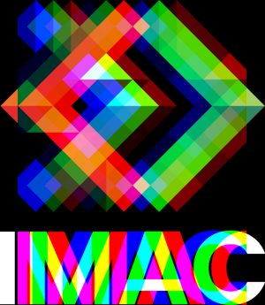
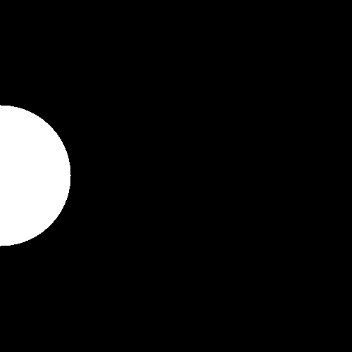
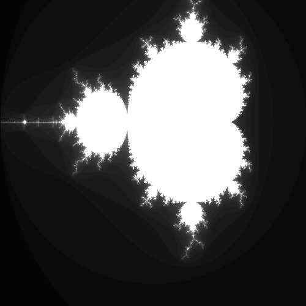
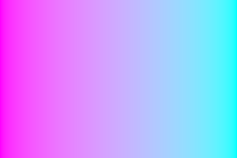

# 🐣 S1 | Prog: Workshop

## ★ NE GARDER QUE LE VERT

## ★ ÉCHANGER LES CANAUX

## ★ NOIR & BLANC

Note : J'ai d'abord essayé d'attribuer à r, g et b la moyenne des trois couleurs, mais le résultat n'était pas celui souhaité. J'ai compris que cela était dû au fait que certaines valeurs étaient modifiées d'un calcul à l'autre. C'est pour cela que j'ai fait le calcul une fois (pour la valeur r) et j'ai duppliqué cette valeur pour les valeurs g et b, afin qu'elles soient parfaitement identiques.

## ★ NÉGATIF

## ★ DÉGRADÉ

## ★★ MIROIR

Note : Lors de mon premier essai, uniquement la première partie de l'image s'inversait, alors que la deuxième restait identique.

## ★★ IMAGE BRUITÉE

Note : Pour m'assurer qu'un nombre assez important de pixels étaient altérés, j'ai fait itérer la boucle un nombre flottant aléatoirement choisi entre le carré du côté le plus petit (la largeur, 300) et l'exposition totale de l'image (300 * 345).

## ★★ ROTATION DE 90°

Note : J'ai réussi à faire tourner l'image de 90°, mais vers la gauche. 

## ★★ RGB SPLIT

Note : J'ai compris rapidement la logique du split, mais j'ai remarqué que l'effet ne se réalisait pas correctement sur les bandes de longeur {gap} aux extrémités de l'image. 

## ★★ LUMINOSITÉ

## ★★(★) DISQUE

Note : la formule du disque est particulièrement lourde dans ma condition, j'ai appris que les puissances ne pouvaient pas se noter avec le symbole ^, comme dans d'autres langages. 
J'ai ajouté à posteriori les coordonnées du centre du cercle dans les paramètres de la fonction, notamment pour m'aider dans l'exercice de la rosace. 

## ★★ CERCLE

## ★★ ANIMATION

## ★★★ ROSACE

## ★★ MOSAÏQUE

## ★★★★ MOSAÏQUE MIROIR

## ★★★ GLITCH

## ★★★ TRI DE PIXELS

## ★★★(★) FRACTALE DE MANDELBROT

## ★★★(★) DÉGRADÉ DANS L'ESPACE DE COULEUR LAB

Note : J'ai eu un peu de mal avec les conversions, et je me suis rendue compte qu'il fallait faire le chemin inverse une fois qu'on avait obtenu des valeurs Oklab, pour pouvoir les lire en sRGB.
Néanmoins, le résultat est satisfaisant et je préfère nettement les dégradés générés dans l'espace de couleur Oklab !

