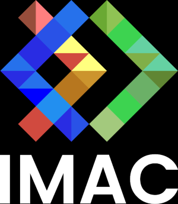
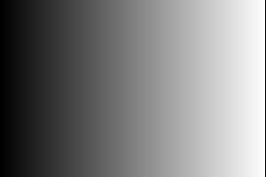
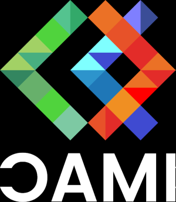
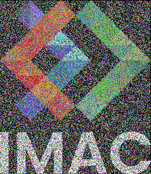
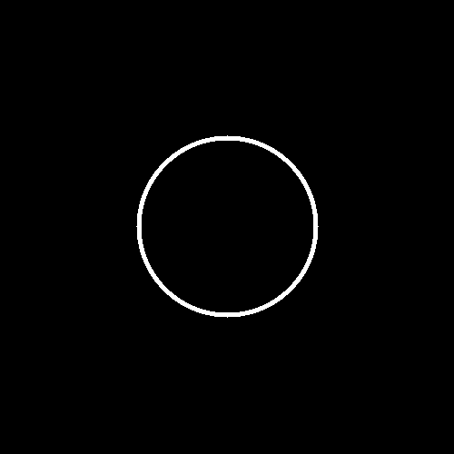
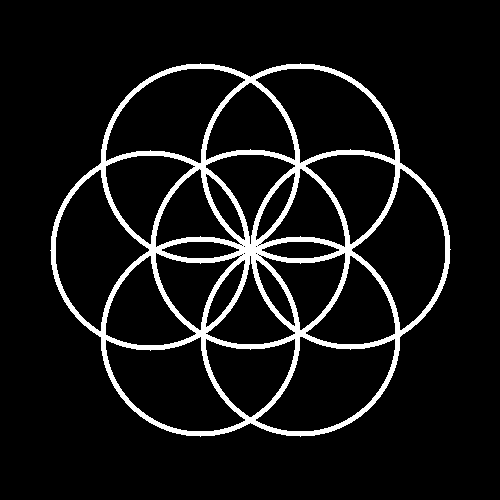
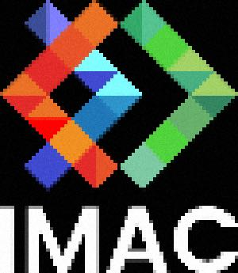
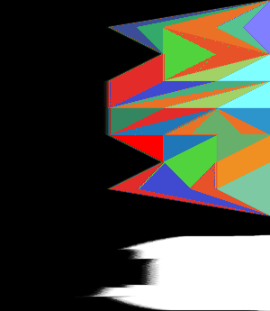

# 🐣 S1 | Prog: Workshop

## ★ NE GARDER QUE LE VERT

## ★ ÉCHANGER LES CANAUX

## ★ NOIR & BLANC

## ★ NÉGATIF

## ★ DÉGRADÉ

## ★★ MIROIR

## ★★ IMAGE BRUITÉE

## ★★ ROTATION DE 90°

## ★★ RGB SPLIT

## ★★ LUMINOSITÉ

## ★★(★) DISQUE

## ★★ CERCLE

## ★★ ANIMATION

## ★★★ ROSACE

## ★★ MOSAÏQUE

## ★★★★ MOSAÏQUE MIROIR

## ★★★ GLITCH

## ★★★ TRI DE PIXELS

